<!-- .slide: class="cover" data-background-image="images/title-background.jpeg" -->


<div class="card">

# The problem: migration is hard !

Charles Moulliard | IBM Sr. Principal Software Engineer - Quarkus

</div>

---

## Migration process looks simple ...

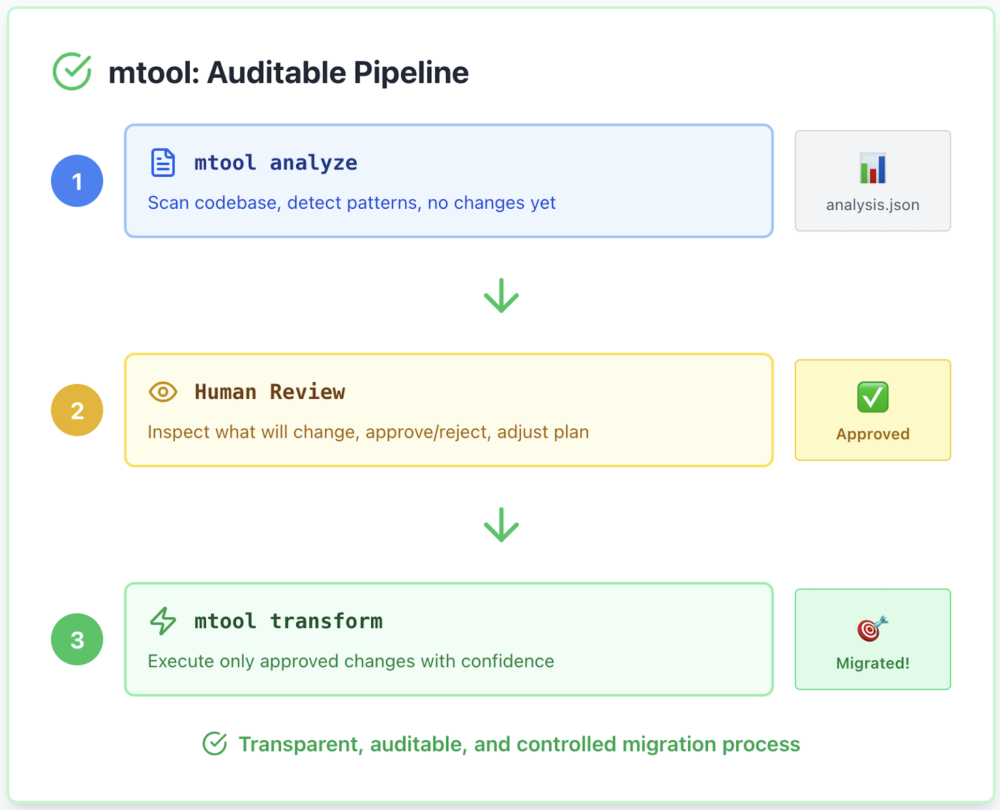 <!-- .element: class="tall" -->

---

### Code/File Analyser

Treesitter, TreeSitter4j, Google Java Parser, OpenRewrite Parsers, ...

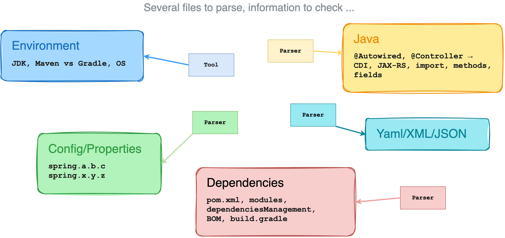

---

### Rule(s) processing

Rule engine, Antlr – query parser, Scanner, ...

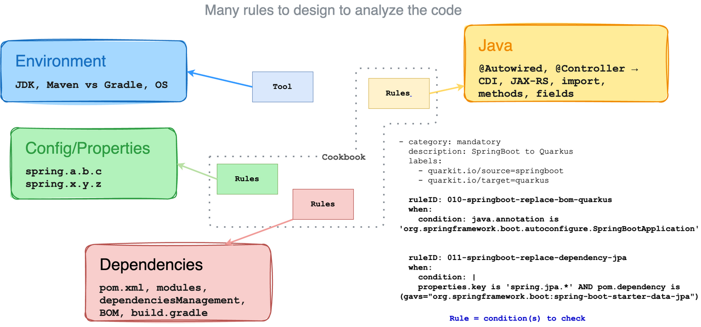

---

### Transformation tool

Openrewrite recipes

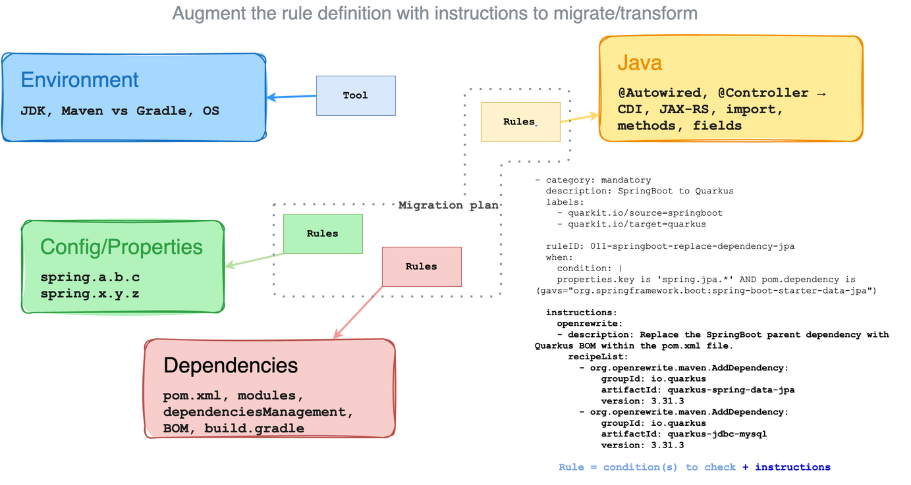

---

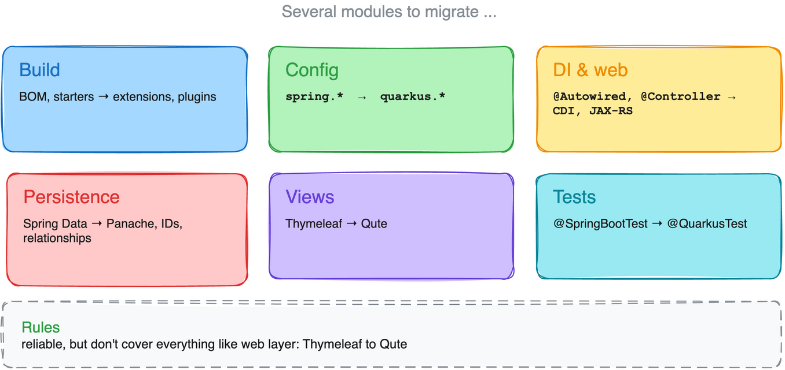 <!-- .element: class="full" -->

---

## Demo part

- **mtool**: Generate Migration plan from Application analyzed
- **mtool**: transform it using instructions
- Run App migrated and observations !

---

<!-- .slide: data-visibility="hidden" -->

### Spring Boot => Quarkus using Openrewrite recipes

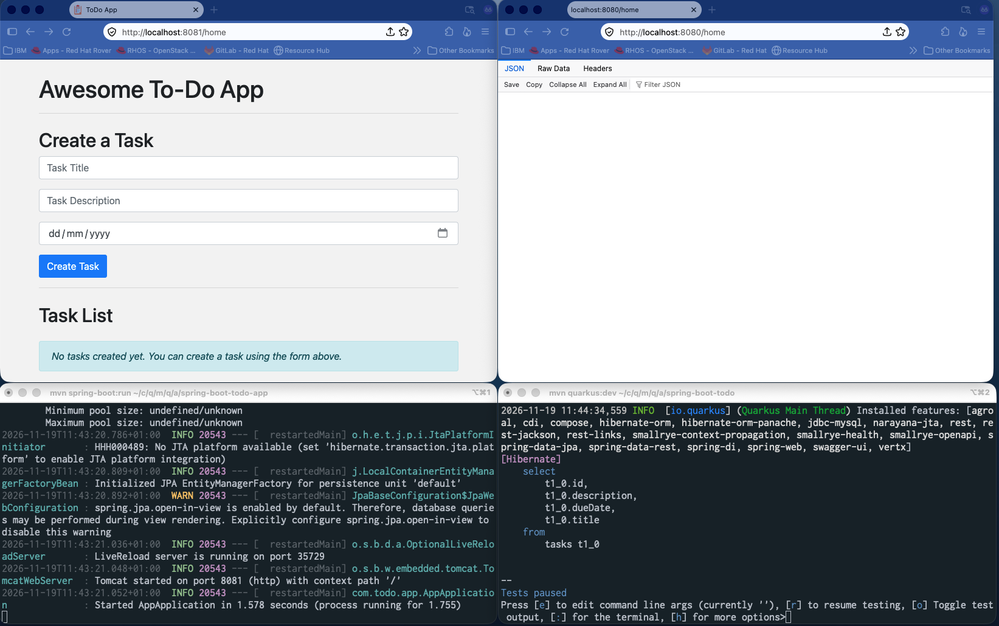

---

<div class="columns">
<div>

- Can another technology help us ?
  - **=> AI** to the rescue
- Mix **providers**: AI + openrewrite + etc
- What we did here => **SKILL = Instructions + tools**
- Mtool 2.x => **Quarkit**

</div>
<div>

```yaml
- category: mandatory
  description: SpringBoot to Quarkus
  labels:
  - quarkit.io/source=springboot
  - quarkit.io/target=quarkus
  ruleID: 011-springboot-replace-dependency-jpa
  when:
    condition: |
      properties.key is 'spring.jpa.*' AND
      pom.dependency is (gavs="org.springframework.boot:spring-boot-starter-data-jpa")
  instructions:
    ai:
    - tasks:
      - "Replace Thymeleaf with Quarkus Qute."
      - "Add the quarkus dependency: quarkus-jdbc-mysql"
      - "Add the quarkus dependency: quarkus-spring-data-jpa, ..."
    openrewrite:
    - description: Replace the SpringBoot parent dependency with Quarkus BOM within the pom.xml file.
```

<p class="source">Source: <a href="https://github.com/snowdrop/migration-tool/blob/66d320c4fb832d777c84b857654035acb313bcdb/cookbook/rules/quarkus-spring/011-springboot-replace-dependency-jpa.yaml">011-springboot-replace-dependency-jpa.yaml</a></p>

</div>
</div>

Note:
Add AI instructions

Mix instructions between providers: AI + openrewrite + x.y.z

---

<!-- .slide: data-visibility="hidden" -->

### Migrating between frameworks is hard

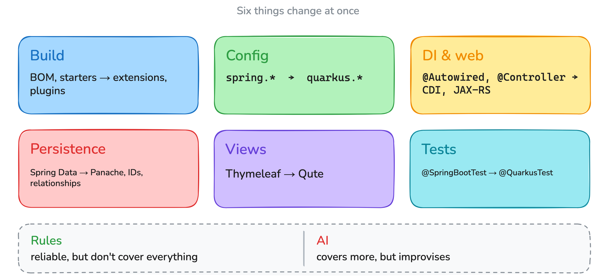

Note:
The full picture looks like this. A deterministic sandwich around the AI.

[AI Skill] In the middle, the skill. It does the work that needs context: controller logic, template conversion, config reasoning, strategy decisions, tests. Tokens, flexible, variable. That's the price of understanding.

[Validators] Next to it, the validators. They are deterministic: pure Java, zero tokens, same result every time. They compare the Quarkus project against the Spring source: project setup, entities and their relations, ID strategies, table names, REST endpoints, configuration, messaging.

[MCP, nota amarilla] And they live in quarkit, our MCP server. If the server is running, the agent discovers the validators as tools and calls them by itself, during the migration.

[feedback loop] When a validator fails, the result goes back to the skill, and the agent fixes it. AI proposes, rules verify.

[Verified Quarkus Project] What comes out is not "a Quarkus project". It's a verified one.

Let's see it run.

The full picture looks like this. A deterministic sandwich around the AI. Before the migration, mtool analyzes the Spring project — scans dependencies, annotations, code patterns — and applies every transformation that has a clear mechanical rule. Import renames, dependency swaps, annotation replacements. No AI involved, no tokens spent, same result every time. Then the AI skill handles what needs understanding: controller logic, template conversion, contextual decisions about strategy. The AI gets a richer starting point because mtool has already done the analysis, so it makes fewer mistakes and spends fewer tokens. After the migration, deterministic validators verify the result — and that's what I want to show you next. One more thing: these deterministic tools can be exposed as MCP tools — discoverable by the AI agent, invoked automatically as part of the migration. The boundary between deterministic and AI isn't a wall, it's an interface.

---

<!-- .slide: class="cover" data-background-image="images/title-background.jpeg" -->


<div class="card">

# Quarkit architecture & vision

Aurea Munoz Hernandez | IBM Principal Software Engineer - Quarkus

</div>

---

### How we built the Migration skill

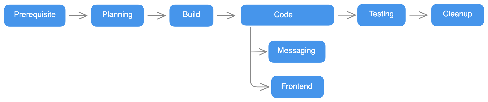 <!-- .element: class="strip" -->

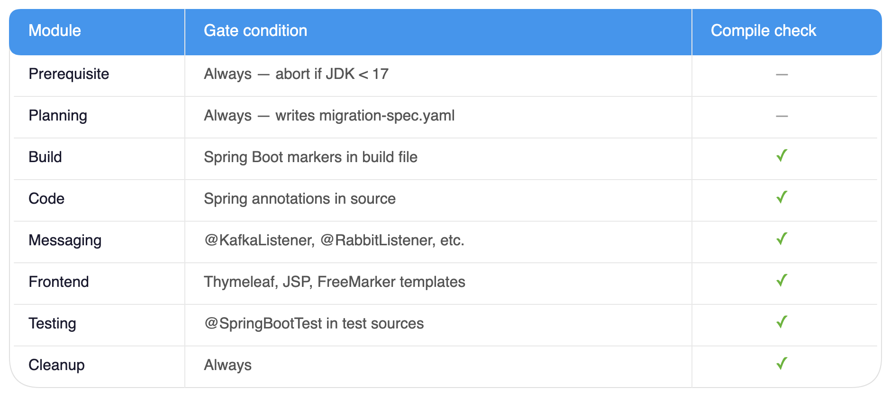 <!-- .element: class="half" -->

Note:
You all know what a skill is: markdown the agent reads. Ours has one particularity: it gives the agent very little freedom.

[señalar el flujo de arriba] It's not one prompt. It's eight modules, in a fixed order. Prerequisite, planning, build, code, testing, cleanup, and two optional ones: messaging and frontend.

[señalar la tabla] Every module has a gate. The agent inspects your project and decides if the module applies. No Thymeleaf templates? Frontend is skipped. No Kafka listeners? Messaging is skipped. It only works on what exists.

And look at the last column. After every module that changes code, the project is compiled. If it fails, there is a fix procedure: three retries, then it stops and asks a human. The agent does not get to "try something" forever.

So the skill controls how the agent works. But who checks the result?

---

## High level view

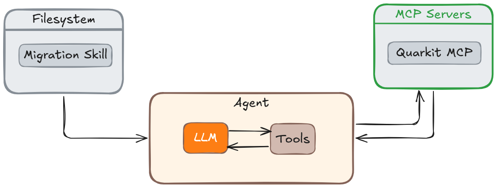

---

## Anatomy of Quarkit

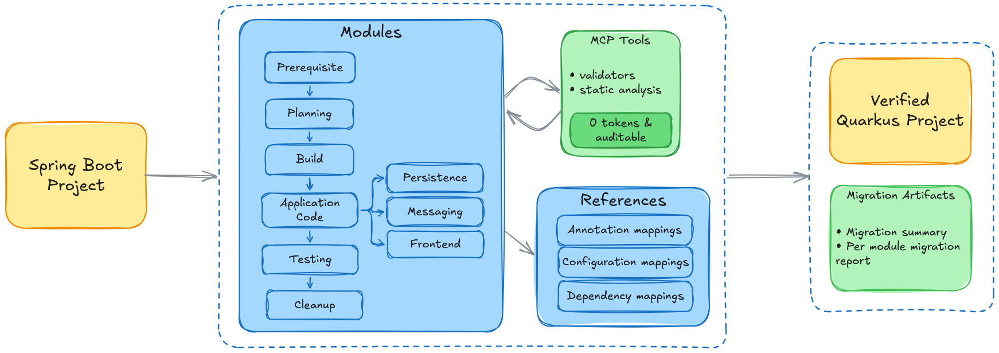

---

<!-- .slide: data-visibility="hidden" -->

### Hybrid: deterministic + AI

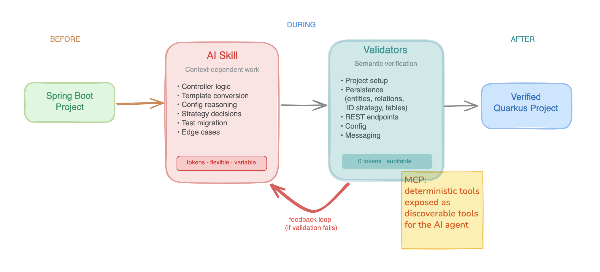

Note:
The full picture looks like this. A deterministic sandwich around the AI.

[AI Skill] In the middle, the skill. It does the work that needs context: controller logic, template conversion, config reasoning, strategy decisions, tests. Tokens, flexible, variable. That's the price of understanding.

[Validators] Next to it, the validators. They are deterministic: pure Java, zero tokens, same result every time. They compare the Quarkus project against the Spring source: project setup, entities and their relations, ID strategies, table names, REST endpoints, configuration, messaging.

[MCP, nota amarilla] And they live in quarkit, our MCP server. If the server is running, the agent discovers the validators as tools and calls them by itself, during the migration.

[feedback loop] When a validator fails, the result goes back to the skill, and the agent fixes it. AI proposes, rules verify.

[Verified Quarkus Project] What comes out is not "a Quarkus project". It's a verified one.

Let's see it run.

---

<!-- .slide: class="cover" data-background-image="images/title-background.jpeg" -->


<div class="card">

# Summary & Roadmap

Aurea & Charles

</div>

---

## Roadmap & future

- **Integrate** the MCP **tools** within the SKILLS
- **Add** new **module/validator/checks** to support additional "starters"
- Package the SKILL / MCP As **Agent Plugin**
- **Develop** additional **tools** for analyze/planning parts
- Measure **token cost & time**, with and without the Quarkit tools
- **Resumable state**: pick up a migration where it stopped
- **Enhance** the **architecture**. Why ? programming the logic part of the SKILL is not natural and could be better handled by a Flow Application

<p class="stamp">Subject to change</p>

---

## Summary

- **Migration** is **hard** => **Tools, Rules** & expertise needed !
- **Tools** alone are **not enough** => to be combined with **AI**
- **Recommendation:**
  - **Adopt** Quarkit: (Skills + instructions + Tools)n + Tools + validators + etc
- **Benefits**
  - **Reduce** migration time: from weeks to hours
  - **Verified** result, not just generated
  - **Traceable**. Every migration produces a plan, a per-module report & a list of what was changed, skipped or removed, and why.
  - Open and portable. Open-source skill and tools, any coding agent (Bob, Claude Code, Codex…)

---

<!-- .slide: class="cover" data-background-image="images/title-background.jpeg" -->


<div class="card">

# Q/A

Aurea & Charles

</div>
